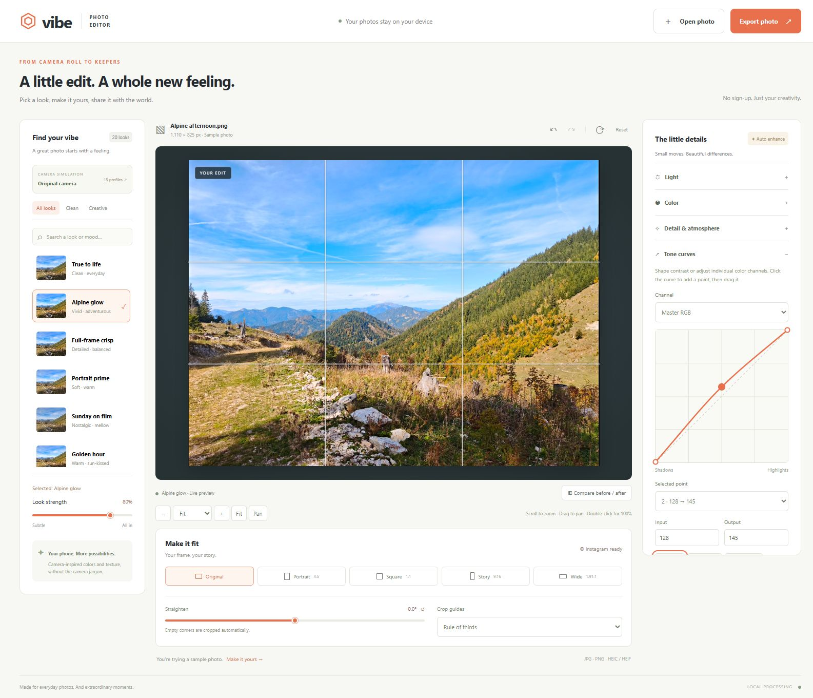
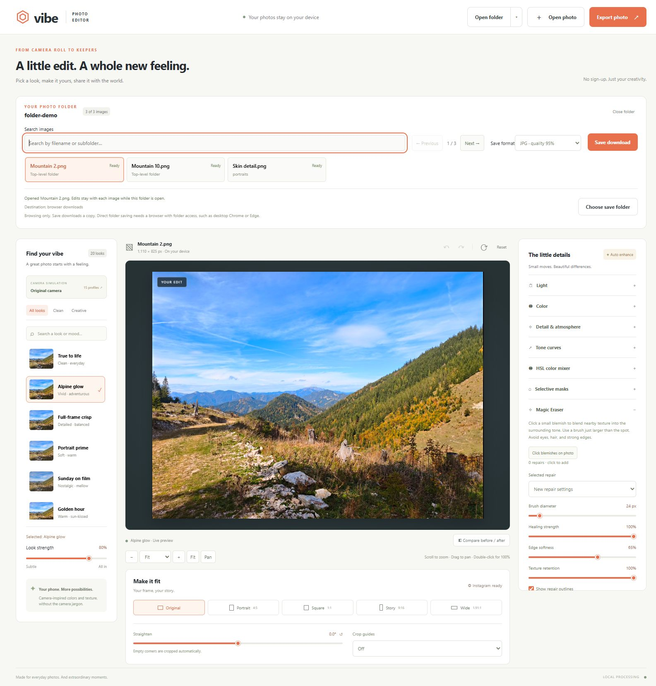
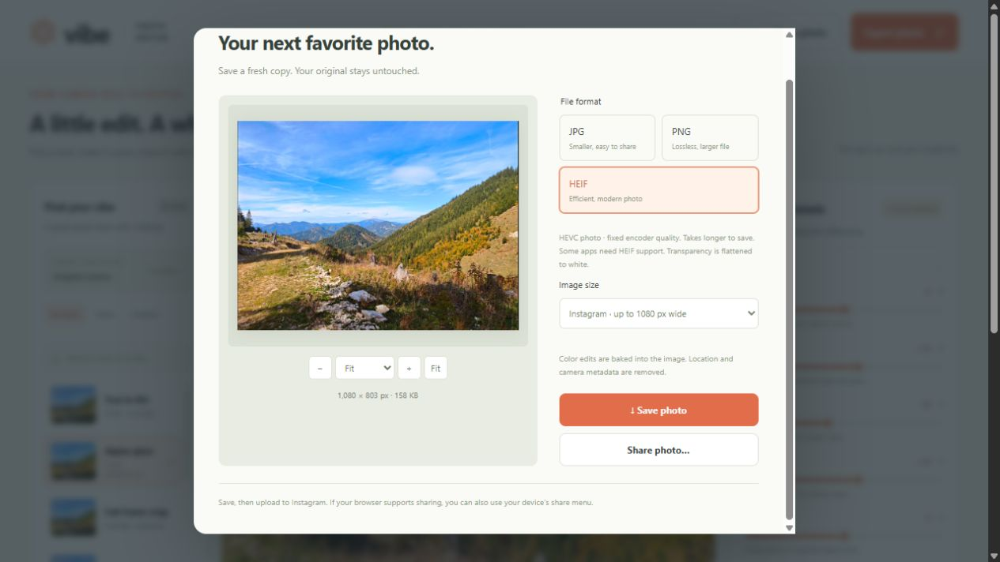

# Vibe Photo Editor

A private photo editor for everyday images, with camera-inspired looks, detailed adjustments, and a zoomable preview. Runs locally in your browser or as a portable Windows desktop app. No account, API key, or photo uploads.



The editor with a custom tone curve and rule-of-thirds guides. HSL color mixing and selective masks are available in the adjustment panel.

## Features

- **20 looks** with mood search and adjustable strength.
- **15 camera-inspired profiles** from Canon, Nikon, Sony, Fujifilm, Hasselblad, and Leica, with an independent strength control.
- **16 adjustments** for light, color, detail, and atmosphere.
- **Master and RGB tone curves** with smooth interpolation, draggable points, and numeric input/output controls.
- **Eight-range HSL mixer** for hue, saturation, and luminance, with smooth transitions between colors.
- **Selective radial, gradient, and brush masks** with feathering, inversion, brush erasing, and six local adjustments.
- **Preview zoom and pan**, including Fit, 100% detail inspection, percentage presets, wheel zoom, and before/after comparison.
- **Crop, rotation, and straightening** with automatic corner trimming, rule-of-thirds guides, and an alignment grid.
- **JPG, PNG, HEIC, and HEIF import**; **JPG, PNG, and HEIF export** with a preview of the actual saved image.
- **Undo/redo** and reversible edits. Export saves a new copy.
- **Local processing** using Canvas and background workers. Bundled codecs keep runtime use offline.
- **Folder workflow** with filename search, previous/next navigation, per-photo drafts, and edited copies saved into an `edited` subfolder.
- **Magic Eraser** for small blemishes, with brush size, healing strength, edge softness, and texture retention controls.
- **Portable Windows EXE** built with Electron, including an app icon and native folder access.

## Quick start

Requires **Node.js 18 or newer** and a recent Chrome, Edge, Firefox, or Safari browser.

```sh
git clone https://github.com/kurta999/VibePhotoEditor.git
cd VibePhotoEditor
npm start
```

Open **http://127.0.0.1:5173**. On Windows, you can also double-click **Start Editor.cmd**. Keep the terminal open while editing; press Ctrl+C to stop the server.

The browser version needs no build step. The HEIF decoder and encoder are bundled in `vendor/`, so running it does not require `npm install` or an Internet connection. To install the pinned packages for dependency maintenance without running install scripts, use `npm ci --ignore-scripts`.

To use another port:

```powershell
# PowerShell
$env:PORT = 5174
npm start
```

```sh
# macOS / Linux
PORT=5174 npm start
```

### Windows desktop app and single EXE build

On **Windows 10/11 x64**, install **Node.js 22.12 or newer**, then run:

```sh
npm ci
npm run build:win
```

Alternatively, double-click **Build Windows App.cmd**. The portable output is **`dist/Vibe-Photo-Editor-1.0.0-win-x64.exe`**. Distribute that one file; it includes Electron, the editor, the sample, and both codecs. Users do not need Node.js, an installer, a running server, or an Internet connection. The EXE extracts its runtime to a temporary directory when launched. Building requires Internet access for the initial dependency/tool downloads and several gigabytes of free space; `dist/` is excluded from Git.

The EXE and desktop window use the Vibe icon in `assets/icon.ico`, with sizes from 16 to 256 px. Its editable source is `assets/icon.svg`; regenerate the Windows icon with `npm run icon`.

For development, run **`npm run desktop`**. **`npm run desktop:smoke`** opens a hidden test window and checks startup, renderer isolation, a real folder read/save round trip through the bridge, Magic Eraser, pixel workers, HEIF export, and HEIC/HEIF decoding. It uses and removes its own temporary image fixture. After building, test the packaged runtime with:

```sh
node scripts/smoke-desktop.mjs "dist/win-unpacked/Vibe Photo Editor.exe"
```

The same check accepts the single portable EXE's path to verify extraction and startup too.

The desktop app uses native **Open folder** and **Choose save folder** dialogs. Save writes fresh copies into `edited` directly; browser folder APIs are not required. Single-photo downloads use a native Save dialog. The renderer is sandboxed and isolated from Node; the preload exposes only folder selection, selected-image reading, and edited-copy saving. Only bundled resources load, and no local web server is started. The current build is unsigned; a signed release requires configuring a Windows signing certificate in electron-builder.

## Editing a photo

1. Open or drop a photo, or try the included mountain sample.
2. Choose a look and adjust its strength. Optionally open **Camera simulation** to choose a camera-inspired profile.
3. Fine-tune the **Light**, **Color**, and **Detail & atmosphere** controls. Slider values combine the chosen styles with your manual adjustments.
   Open **Tone curves** or **HSL color mixer** for precise tonal and color edits. Use **Selective masks** to adjust a specific region.
4. Inspect detail with zoom and pan. Enable **Compare before / after** to compare the same crop and rotation. Use **Pan** to move the photo while comparing.
5. Choose a crop and reposition it with the frame sliders. Use **Straighten** (±15°) to level the photo and **Crop guides** to align the composition.
6. Open **Export photo**, choose a format and size, inspect the export preview, and save a copy. Device file sharing is available when supported by the browser.

Choosing a look clears the basic manual adjustment offsets and retains the camera, curves, HSL edits, masks, and spot repairs. Changing cameras retains your manual edits. A basic slider reset returns that slider to the selected styles. Undo/redo includes styles, strengths, curves, HSL, masks, spot repairs, crop, rotation, and straightening. **Reset** clears all edits and returns to the original image.

### Curves, color, and masks

- **Tone curves:** choose Master RGB, Red, Green, or Blue. Click the graph or **Add point** to create a control point (up to 12 per channel). Drag it, or edit its 0–255 input and output values. Endpoints keep their input positions but can change output. **Reset channel** restores a diagonal curve. Curves use smooth, shape-preserving interpolation.
- **HSL:** select Red, Orange, Yellow, Green, Aqua, Blue, Purple, or Magenta. Adjust hue (±60°), saturation, and luminance. Neighboring ranges blend smoothly; neutral grays are protected. Reset a single range or all colors.
- **Masks:** add up to four masks. A radial mask selects a feathered circle; a gradient fades from its full-effect edge to its no-effect edge; a brush selects painted areas. **Draw on photo** enables drawing, and **Done drawing** returns to zoom/pan. The drawing bar links back to the local controls on smaller screens. Use numeric position sliders for radial and gradient geometry.
- Each mask supports local brightness, contrast, highlights, shadows, saturation, and warmth. **Enabled** toggles its effect, **Invert** reverses the selection, and **Show overlay** displays the selected region in pink. Masks apply in list order and follow the original photo through crop, rotation, and straightening.
- Brush size and feather apply to new strokes. Enable **Erase brush strokes** to remove painted areas. A brush mask supports up to 64 strokes, with up to 512 sampled points per stroke. Undo/redo includes painting and erasing. Delete a mask to remove both its selection and local edits.
- Guides, mask overlays, and mask outlines are preview aids and never appear in exported images. Straightening zooms into the image enough to remove empty corners; it does not invent missing image content.

### Keyboard and pointer controls

| Action | Control |
| --- | --- |
| Undo / redo | Ctrl+Z / Ctrl+Shift+Z (Cmd on macOS), outside form controls |
| Zoom | Mouse wheel, +/− buttons, percentage menu, or pinch |
| Fit / 100% | 0 / 1 while the preview is focused |
| Toggle Fit / 100% | Double-click the preview |
| Pan | Drag, or arrow keys while the preview is focused |
| Move comparison divider | Drag the divider, or arrow keys while its slider is focused |
| Close a dialog | Escape |
| Move a selected curve point | Arrow keys while the curve graph is focused; Shift for larger steps |
| Delete a curve point | Delete / Backspace while the graph is focused (interior points only) |
| Previous / next folder photo | Alt+Left / Alt+Right, outside form controls |

### Working through a folder

1. Click **Open folder** and choose a local photo folder. Supported JPG, PNG, HEIC, and HEIF images are listed by name, including nested folders. Existing `edited` subfolders and unsupported files are skipped. Up to 10,000 image entries are supported; photos are decoded one at a time.
2. Search by filename or subfolder path, click an image, or use **Previous / Next**. Navigation follows the current search results. Each image keeps its own draft and undo/redo history while the folder is open. Ready, Unsaved edits, and Saved badges show progress.
3. Choose JPG (95% quality), PNG, or HEIF in **Save format**, then click **Save to edited**. In the browser, allow its write permission prompt when requested. The app saves at full working resolution with the current crop and edits, under `<chosen folder>/edited/`. Nested source paths are retained, and existing copies receive numbered filenames instead of being overwritten.
4. Use **Export photo** for custom dimensions or JPG quality; its Save button writes the prepared copy to the same `edited` destination when a folder photo is selected.

The Windows app supports direct disk saving through its native folder dialogs. In the browser version, direct disk saving requires the [File System Access API](https://developer.chrome.com/docs/capabilities/web-apis/file-system-access), available in supporting desktop browsers such as Chrome and Edge. The arrow beside **Open folder** offers **Browse folder files** for read-only browsing. In this mode **Save download** downloads a copy; it does not create an `edited` folder. Where supported, **Choose save folder** connects a directory and saves into its `edited` subfolder.

Original files are never replaced. Drafts are held in memory, so save copies before closing or refreshing. The app warns before discarding unsaved folder drafts. Opening a single photo retains the folder's drafts so you can resume by clicking a listed image.



Folder browsing with Magic Eraser open. The pictured browse-only mode uses downloads; opening a folder with direct access enables saving to its `edited` subfolder.

### Magic Eraser: spot healing

Open **Magic Eraser**, set **Brush diameter** just larger than a blemish, and enable **Click blemishes on photo**. Click individual spots, then use **Done healing** to resume zoom/pan. **Selected repair** lets you tune or remove an existing repair; select **New repair settings** to configure future clicks.

- **Healing strength** blends the repair with the original pixels.
- **Edge softness** controls the transition at the brush boundary.
- **Texture retention** controls how much neighboring texture is retained.
- **Show repair outlines** is a preview aid. It is excluded from saved files.

The tool chooses nearby pixels, matches their color and lighting to the surrounding area, and blends them into the selected circle. It runs on the full working image in a background worker before crop, rotation, styles, and export. Before/after comparison includes the unrepaired original, and repairs follow each folder photo's history. Up to 80 repairs per photo are supported.

Best suited to small spots surrounded by similar texture. Strong edges, hair, large objects, and image corners may not provide a suitable donor area. It does not generate new content or apply a global skin blur; the supplied photo must contain usable nearby texture.

## Formats and export

| Format | Import | Export | Notes |
| --- | --- | --- | --- |
| JPG / JPEG | Yes | Yes | Adjustable quality; transparent areas become white |
| PNG | Yes | Yes | Lossless output; preserves transparency |
| HEIC / HEIF | Yes | Yes, `.heif` | HEVC-compressed export; fixed encoder quality; transparent areas become white |

HEIF encoding runs in a disposable background worker and takes longer than JPG/PNG. The export preview is decoded from the saved HEIF bytes. Some receiving apps require HEIF support. Changing format or size, or closing the export dialog, cancels ongoing HEIF encoding.

**Instagram** export limits width to 1080 px without upscaling. **Full working resolution** uses the full in-memory image; **2048 px** limits its longest edge. **Custom dimensions** lets you enter width or height in pixels, with the other dimension linked to your crop aspect ratio. Custom export accepts whole numbers, stays within the working crop resolution and 16 MP / 8192 px limits, and does not upscale. Choose a different crop to change the aspect ratio. All modes include curves, HSL, local masks, and straightening.



## Privacy and image limits

- Photos and edits stay on your device. The static server listens only on `127.0.0.1`; the app makes no external network requests.
- Files over 120 MB are rejected. Images above 16 megapixels or 8192 px on their longest edge are downsampled to a safe working copy; the interface reports this.
- Fit preview uses up to 1400 px on its longest edge. Percentage zoom renders the full working crop for detail inspection. Export reruns the shared engine at the selected size; pixel-scale effects can vary slightly with resolution.
- Export strips source metadata, including location. HEIF import edits the primary image; sequences, Live Photos, depth maps, and auxiliary images are not retained.
- This is an **8-bit SDR Canvas workflow**. RAW processing, HDR output, calibrated wide-gamut color, and original metadata preservation are outside its scope.
- Edits are held in memory. **Closing or refreshing the tab loses unsaved edits.**

Camera profiles are hand-tuned aesthetic approximations, not manufacturer LUTs, calibrated sensor simulations, or resolution upgrades. Background softness is a radial blur without subject detection; haze removal is a global adjustment. See [camera profile notes](docs/CAMERA_PROFILES.md).

## Development

```sh
npm run check
npm test
```

The 41 tests cover pixel processing, camera/look stacking, curves/HSL, masks and coordinate alignment, custom export validation, zoom/pan, HEIF round trips, folder enumeration and real filesystem writes, spot healing with texture and alpha preservation, and desktop folder access boundaries. Windows junction tests require permission to create junctions. Browser and desktop checks and their limitations are recorded in [tests/VALIDATION.md](tests/VALIDATION.md).

| File | Purpose |
| --- | --- |
| `app.js` | UI, import, edit history, preview, and export orchestration |
| `engine.js` | Shared pixel processing and crop/export geometry |
| `advanced.js` | Curves, HSL, mask rasterization, coordinate transforms, and custom sizing |
| `advanced-ui.js` | Curves/color controls and mask drawing interactions |
| `folder-library.js`, `folder-ui.js` | Folder enumeration, search, drafts, permissions, and edited-copy saving |
| `healing.js`, `healing-ui.js` | Local texture healing and the Magic Eraser controls |
| `cameras.js` | Camera-inspired profile definitions |
| `worker.js` | Background pixel processing |
| `preview-zoom.js` | Editor/export zoom and pan |
| `heif-codec.js`, `heif-worker.js` | Local HEIF encoding |
| `index.html`, `styles.css` | Interface and responsive layout |
| `server.mjs` | Loopback static server |
| `desktop/` | Electron window, isolated preload, and scoped native folder access |
| `assets/icon.svg`, `assets/icon.ico` | App icon source and Windows icon |
| `scripts/` | Icon generation and packaged-app smoke check |
| `vendor/` | Bundled codecs and their license notices |

Edit source files and refresh the browser, or restart the desktop app. Keep dependency versions pinned, run checks, and update [THIRD_PARTY_NOTICES.md](THIRD_PARTY_NOTICES.md) when replacing a codec. The desktop wrapper follows [Electron's security guidance](https://www.electronjs.org/docs/latest/tutorial/security), and the portable target uses [electron-builder](https://www.electron.build/v26/docs/win/).

## Contributing

Bug reports and focused pull requests are welcome. Include reproduction steps, browser/OS details, and expected behavior. Use a non-sensitive sample image when needed. For processing changes, add a regression test and check preview/export consistency; for UI changes, check keyboard access and narrow screens.

## License

The original application code is available under the **[MIT License](LICENSE)**, copyright 2026 Vibe Photo Editor contributors.

Bundled codecs retain their own MIT, LGPL, and BSD licenses. The MIT license does not relicense third-party components or grant additional rights to the user-supplied sample photograph. See [third-party notices](THIRD_PARTY_NOTICES.md) and the notices in `vendor/` for attribution, source links, and replacement instructions.
