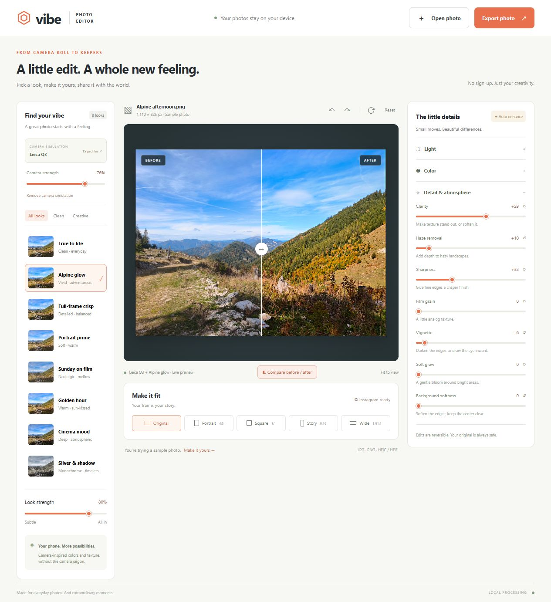

# Vibe Photo Editor

A private photo editor for everyday images, with camera-inspired looks, detailed adjustments, and a zoomable preview. Runs locally in your browser. No account, API key, or photo uploads.



## Features

- **20 looks** with mood search and adjustable strength.
- **15 camera-inspired profiles** from Canon, Nikon, Sony, Fujifilm, Hasselblad, and Leica, with an independent strength control.
- **16 adjustments** for light, color, detail, and atmosphere.
- **Preview zoom and pan**, including Fit, 100% detail inspection, percentage presets, wheel zoom, and before/after comparison.
- **Crop and rotation** with portrait, square, story, wide, and original aspect ratios.
- **JPG, PNG, HEIC, and HEIF import**; **JPG, PNG, and HEIF export** with a preview of the actual saved image.
- **Undo/redo** and reversible edits. Export saves a new copy.
- **Local processing** using Canvas and background workers. Bundled codecs keep runtime use offline.

## Quick start

Requires **Node.js 18 or newer** and a recent Chrome, Edge, Firefox, or Safari browser.

```sh
git clone https://github.com/kurta999/VibePhotoEditor.git
cd VibePhotoEditor
npm start
```

Open **http://127.0.0.1:5173**. On Windows, you can also double-click **Start Editor.cmd**. Keep the terminal open while editing; press Ctrl+C to stop the server.

There is no build step. The HEIF decoder and encoder are bundled in `vendor/`, so running the editor does not require `npm install` or an Internet connection. To install the pinned packages for dependency maintenance, use `npm ci --ignore-scripts`.

To use another port:

```powershell
# PowerShell
$env:PORT = 5174
npm start
```

```sh
# macOS / Linux
PORT=5174 npm start
```

## Editing a photo

1. Open or drop a photo, or try the included mountain sample.
2. Choose a look and adjust its strength. Optionally open **Camera simulation** to choose a camera-inspired profile.
3. Fine-tune the **Light**, **Color**, and **Detail & atmosphere** controls. Slider values combine the chosen styles with your manual adjustments.
4. Inspect detail with zoom and pan. Enable **Compare before / after** to compare the same crop and rotation. Use **Pan** to move the photo while comparing.
5. Choose a crop and reposition it with the frame sliders.
6. Open **Export photo**, choose a format and size, inspect the export preview, and save a copy. Device file sharing is available when supported by the browser.

Choosing a look clears manual adjustment offsets and retains the camera selection. Changing cameras retains manual offsets. A slider reset returns that slider to the selected styles. Undo/redo includes styles, strengths, adjustments, crop, and rotation.

### Keyboard and pointer controls

| Action | Control |
| --- | --- |
| Undo / redo | Ctrl+Z / Ctrl+Shift+Z (Cmd on macOS), outside form controls |
| Zoom | Mouse wheel, +/− buttons, percentage menu, or pinch |
| Fit / 100% | 0 / 1 while the preview is focused |
| Toggle Fit / 100% | Double-click the preview |
| Pan | Drag, or arrow keys while the preview is focused |
| Move comparison divider | Drag the divider, or arrow keys while its slider is focused |
| Close a dialog | Escape |

## Formats and export

| Format | Import | Export | Notes |
| --- | --- | --- | --- |
| JPG / JPEG | Yes | Yes | Adjustable quality; transparent areas become white |
| PNG | Yes | Yes | Lossless output; preserves transparency |
| HEIC / HEIF | Yes | Yes, `.heif` | HEVC-compressed export; fixed encoder quality; transparent areas become white |

HEIF encoding runs in a disposable background worker and takes longer than JPG/PNG. The export preview is decoded from the saved HEIF bytes. Some receiving apps require HEIF support. Changing format or size, or closing the export dialog, cancels ongoing HEIF encoding.

**Instagram** export limits width to 1080 px without upscaling. **Full working resolution** uses the full in-memory image; **2048 px** limits its longest edge. All modes respect your crop.


## Privacy and image limits

- Photos and edits stay on your device. The static server listens only on `127.0.0.1`; the app makes no external network requests.
- Files over 120 MB are rejected. Images above 16 megapixels or 8192 px on their longest edge are downsampled to a safe working copy; the interface reports this.
- Fit preview uses up to 1400 px on its longest edge. Percentage zoom renders the full working crop for detail inspection. Export reruns the shared engine at the selected size; pixel-scale effects can vary slightly with resolution.
- Export strips source metadata, including location. HEIF import edits the primary image; sequences, Live Photos, depth maps, and auxiliary images are not retained.
- This is an **8-bit SDR Canvas workflow**. RAW processing, HDR output, calibrated wide-gamut color, and original metadata preservation are outside its scope.
- Edits are held in memory. **Closing or refreshing the tab loses unsaved edits.**

Camera profiles are hand-tuned aesthetic approximations, not manufacturer LUTs, calibrated sensor simulations, or resolution upgrades. Background softness is a radial blur without subject detection; haze removal is a global adjustment. See [camera profile notes](docs/CAMERA_PROFILES.md).

## Development

```sh
npm run check
npm test
```

The tests cover pixel processing, camera/look stacking, adjustment controls, crop/export geometry, zoom/pan boundaries, and HEIF encoding round trips. Browser checks and their limitations are recorded in [tests/VALIDATION.md](tests/VALIDATION.md).

| File | Purpose |
| --- | --- |
| `app.js` | UI, import, edit history, preview, and export orchestration |
| `engine.js` | Shared pixel processing and crop/export geometry |
| `cameras.js` | Camera-inspired profile definitions |
| `worker.js` | Background pixel processing |
| `preview-zoom.js` | Editor/export zoom and pan |
| `heif-codec.js`, `heif-worker.js` | Local HEIF encoding |
| `index.html`, `styles.css` | Interface and responsive layout |
| `server.mjs` | Loopback static server |
| `vendor/` | Bundled codecs and their license notices |

Edit source files and refresh the browser. Keep dependency versions pinned, run checks, and update [THIRD_PARTY_NOTICES.md](THIRD_PARTY_NOTICES.md) when replacing a codec.

## Contributing

Bug reports and focused pull requests are welcome. Include reproduction steps, browser/OS details, and expected behavior. Use a non-sensitive sample image when needed. For processing changes, add a regression test and check preview/export consistency; for UI changes, check keyboard access and narrow screens.

## License

The original application code is available under the **[MIT License](LICENSE)**, copyright 2026 Vibe Photo Editor contributors.

Bundled codecs retain their own MIT, LGPL, and BSD licenses. The MIT license does not relicense third-party components or grant additional rights to the user-supplied sample photograph. See [third-party notices](THIRD_PARTY_NOTICES.md) and the notices in `vendor/` for attribution, source links, and replacement instructions.
